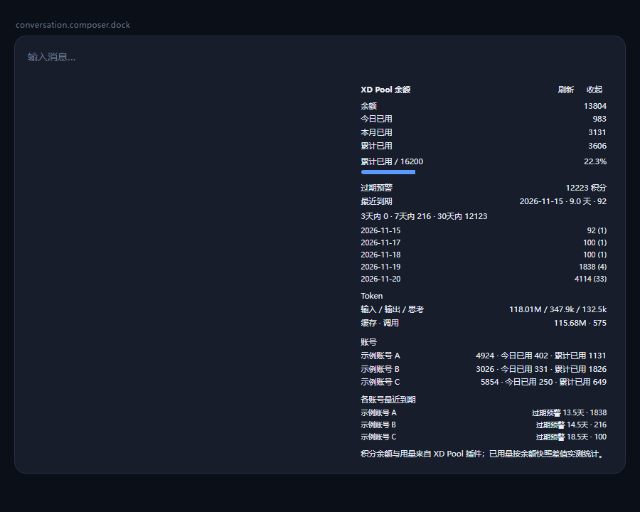

# dsh-xdpool-billing

XD Pool（WorkBuddy）的**积分计费面板**：在输入区下方常驻一枚小胶囊，点击展开看余额与已用明细。

> **依赖**：[`dsh-xdpool`](https://github.com/XDTrees/dsh-xdpool) 提供数据源，本插件不替代它。未安装时面板显示「数据源不可用」而不是空白卡片。



> 截图为示例数据，不是任何真实账号。

## 数据从哪来

本插件**不重复实现上游协议**，只读 XD Pool 插件（`dsh-xdpool`）自己已经挂在同一台 Web 服务器上的两个只读路由：

| 路由 | 内容 |
|---|---|
| `GET /plugins/dsh-xdpool/status?region=cn\|global` | 每个账号的剩余积分 `credits.total` 与积分包明细 `credits.packages` |
| `GET /plugins/dsh-xdpool/usage` | token 用量账本（输入/输出/思考/缓存、调用数、每模型与每账号聚合） |

XD Pool 未安装或未启用时路由不存在，面板显示「数据源不可用」而不是空白卡片。

## 「快过期」预警

积分包大多是有期限的，不用就作废。面板给出三层信息，从急到缓：

1. **最近一次到期** —— 还有多少天、过期多少积分、哪个账号的哪个包。折叠状态下胶囊上直接亮一个 `⏳ 5.9d` 红色角标（7 天内才亮）。
2. **3 / 7 / 30 天分档** —— 各档累计多少积分要过期。**这是累计口径**：7 天档包含 3 天档，所以这几个数不能相加。
3. **到期日历** —— 哪一天会过期多少，用来安排「先把快过期的花掉」。

只统计**一次性包**（`monthly=false`）。月度包按周期刷新，不存在过期作废，把它算进「快过期」会吓用户以为要丢钱。

> 上游的 `credits.expiringSoon` 用的是 **3 天**窗口（`SOON_MS = 2592e5` ms）。实测「3.9 天后到期」的一大批积分在上游那里显示成 `expiringSoon: 0`，所以这里自己分档算。窗口可用环境变量 `XDPOOL_BILLING_EXPIRY_WINDOWS=3,7,30,60` 覆盖。

## 「已使用多少」的两个口径

面板同时给出两个数，并且分清是**实测**还是**推算**：

1. **实测消耗（measured）**——本插件每 60 秒记一次余额快照，余额**下降**的部分就是这段时间真实花掉的积分。签到、领券、新开积分包导致的余额上升不计为消耗。月度包重置也不影响这个数，因为它是差额而不是绝对值。
2. **按包推算（packages）**——每个一次性积分包都带 `remain/size`，`size - remain` 就是这个包已经用掉的量。月度包按周期重置，它的消耗只代表「本周期已用」，因此单列、不并入累计。

## 落盘与接口

- 账本：`$DSH_HOME/storages/xdpool-billing/ledger.json`（按天聚合 + 每账号基线）
- 面板数据：`GET /__xdpool-billing/state.json`（加 `?refresh=1` 可立即拉一次上游）
- Agent 工具：`xdpool_billing`（同一份数据，带 `refresh` 参数）

## 安装

从插件市场装（推荐）：

```bash
dsh plugin --profile desktop add dsh-xdpool-billing
```

从源码装：

```bash
git clone https://github.com/Xun-Prog/dsh-xdpool-billing.git
dsh plugin --profile desktop add ./dsh-xdpool-billing
```

装完刷新页面，输入区下方就会出现那枚胶囊。

## 数据与隐私

本插件**不联网**。它读的是同一台 DSH Web 服务器上 `dsh-xdpool` 已经暴露的两个本地路由，不访问任何外部域名，不读取、不解密 WorkBuddy 凭据。账本只写本机 `$DSH_HOME/storages/xdpool-billing/ledger.json`。

## 排错

**面板显示「数据源不可用」** —— 这几乎总是**上游**的问题，不是本插件坏了。按顺序查：

1. `dsh-xdpool` 装了吗、启用了吗？本插件只读它的两个路由，它不在了面板就没有数据。
2. 打开 `http://127.0.0.1:<你的端口>/plugins/dsh-xdpool/status?region=cn` 看还通不通。**404 = 上游改了路由或没启用**，这是最可能的一种。
3. 面板数据端点本身：`curl http://127.0.0.1:<端口>/__xdpool-billing/state.json`，里面 `ok` 和 `reason` 字段会直接写明原因（`xdpool-not-available(404)` / `xdpool-status-unavailable` / `N account(s) balance unavailable`）。

**余额显示「未知 (N)」** —— 有账号的余额没查到。这是刻意的：把查不到的账号当 0 会读成「余额掉了几千」。通常是那个账号的登录过期了。

**国际版账号余额是空的** —— 上游国际版网关没有积分系统，这是事实不是缺陷。

## 开发

```bash
node --test test/billing.test.mjs test/client-balance.test.mjs
```

## 说明

- 面板渲染在 `conversation.composer.dock` 槽位，样式只用宿主主题令牌（`--dsw-alias-*`），中英双语走宿主 locale。
- 余额总额在**有账号查询失败**时显示「未知 (N)」并列出已知部分，而不是把失败账号当 0 —— 那会读成「余额掉了几千」。
- XD Pool 的国际版网关没有积分系统，所以国际版账号的余额会是空值，这是上游的事实而不是插件的缺陷。
- 数据源只有一个：`dsh-xdpool` 的两个只读路由。它改路由，本插件就要跟着改——这是「不重复实现上游协议」换来的薄，也是它的代价。

## License

[MIT](./LICENSE)

